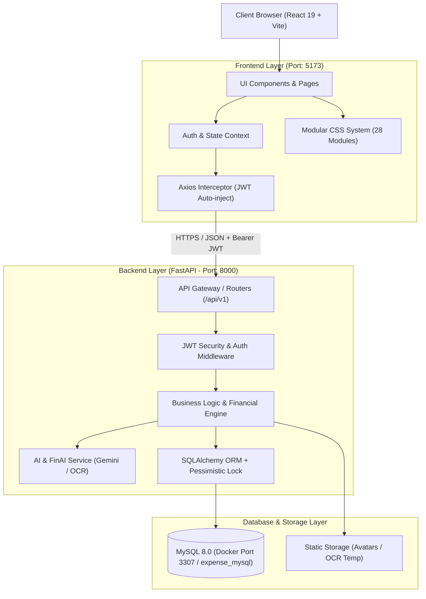
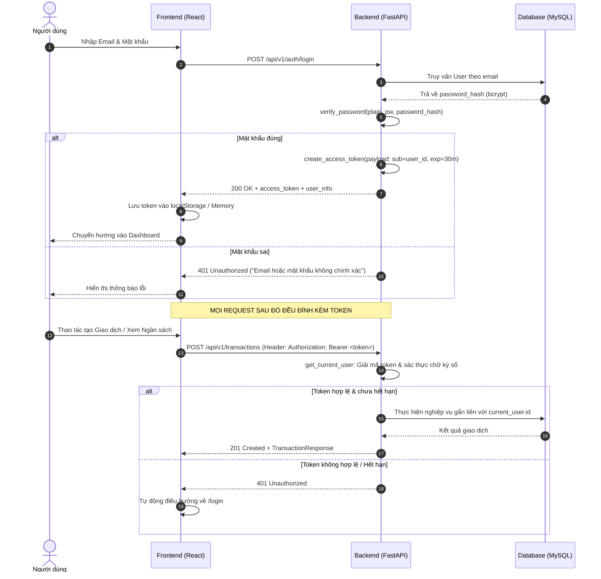
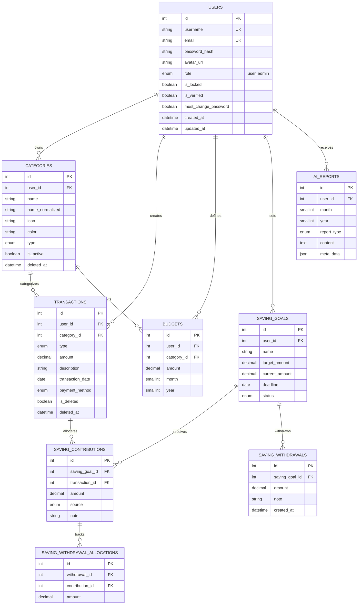
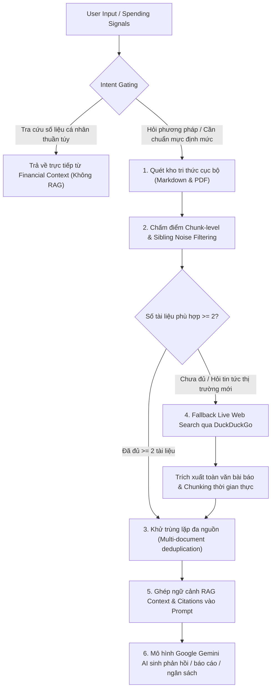

# KIẾN TRÚC HỆ THỐNG — PERSONAL EXPENSE AI

Tài liệu đặc tả kiến trúc kỹ thuật toàn diện cho hệ thống **Quản lý Chi tiêu Cá nhân Tích hợp AI (Personal Expense AI)**.

---

## 1. TỔNG QUAN KIẾN TRÚC (ARCHITECTURAL OVERVIEW)

Hệ thống được xây dựng theo mô hình **Phân tầng (Layered Architecture)** kết hợp kiến trúc hướng dịch vụ RESTful API, đảm bảo phân tách rõ ràng giữa giao diện người dùng (Frontend), tầng xử lý nghiệp vụ (Backend) và tầng lưu trữ dữ liệu (Database).



---

## 2. PHÂN BỐ CẤU TRÚC THƯ MỤC CHUẨN (5 PHÂN HỆ TIÊU CHUẨN)

Dự án được chuẩn hóa theo đúng cấu trúc tiêu chuẩn công nghiệp gồm 5 thư mục cốt lõi:

```text
personal-expense-ai/
├── 🌐 frontend/                # [FRONTEND] React 19 + Vite (Component & Page Architecture)
│   ├── src/
│   │   ├── api/                # Axios API client modules
│   │   ├── components/         # Reusable UI (Modals, Popups, DatePicker, FinAI Mascot)
│   │   ├── constants/          # Application constants & presets
│   │   ├── context/            # Global Auth & App State Context
│   │   ├── hooks/              # Custom React Hooks
│   │   ├── pages/              # Màn hình ứng dụng & Co-located Unit Tests
│   │   │   ├── admin/          # AdminPage & Dashboard quản trị viên
│   │   │   ├── Budgets.jsx     # Quản lý ngân sách & tiến độ chi tiêu (+ Budgets.test.jsx)
│   │   │   ├── Categories.jsx  # Quản lý danh mục thu/chi (+ Categories.test.jsx)
│   │   │   ├── Dashboard.jsx   # Tổng quan số dư ví & biểu đồ
│   │   │   ├── Login.jsx, Register.jsx, ForgotPassword.jsx, ResetPassword.jsx # Xác thực
│   │   │   ├── Profile.jsx     # Quản lý thông tin & mật khẩu (+ Profile.test.jsx)
│   │   │   ├── SavingGoals.jsx # Mục tiêu tích lũy & nạp/rút (+ SavingGoals.test.jsx)
│   │   │   ├── Statistics.jsx  # Báo cáo & phân tích AI (+ Statistics.test.jsx)
│   │   │   └── Transactions.jsx, TransactionTrash.jsx # Quản lý giao dịch thu chi
│   │   ├── styles/             # Hệ thống 28 file CSS module hóa (base, components, layout, pages)
│   │   ├── test/               # Cấu hình kiểm thử Vitest & mocks
│   │   ├── utils/              # Helper functions (Định dạng tiền tệ, ngày tháng UTC+7)
│   │   ├── App.jsx             # React Router & ProtectedRoute
│   │   ├── index.css           # Master CSS Hub (@import)
│   │   └── main.jsx            # Entry point ứng dụng React
│   ├── .env.example            # Vite frontend environment template
│   ├── package.json            # Quản lý dependencies frontend (Vitest 71 tests)
│   └── vite.config.js          # Cấu hình Vite & proxy
│
├── ⚙️ backend/                 # [BACKEND] Kiến trúc 3 lớp (3-Tier) với FastAPI & SQLAlchemy
│   ├── app/
│   │   ├── api/routes/         # Thin Controllers: Tiếp nhận HTTP request & ủy quyền cho Service
│   │   │   ├── admin.py        # Router phân hệ quản trị viên (Admin Portal)
│   │   │   ├── ai.py, chat.py, ocr.py # Router AI Báo cáo, Trợ lý FinAI & Quét hóa đơn OCR
│   │   │   ├── auth.py         # Router xác thực JWT, OTP kích hoạt & đổi mật khẩu
│   │   │   ├── budgets.py      # Router quản lý ngân sách tháng
│   │   │   ├── categories.py   # Router danh mục thu/chi & Soft-hide
│   │   │   ├── saving_goals.py # Router mục tiêu tiết kiệm, nạp/rút tiền (FIFO)
│   │   │   └── transactions.py # Router giao dịch thu/chi, khóa dòng & thùng rác
│   │   ├── services/           # Service Layer: Đóng gói 100% nghiệp vụ tài chính & tính toán
│   │   │   ├── admin_service.py # Xử lý khóa tài khoản, cấp pass tạm, telemetry AI
│   │   │   ├── auth_service.py  # Xử lý đăng ký, đăng nhập, token, đổi mật khẩu
│   │   │   ├── budget_service.py # Xử lý ngân sách, cảnh báo ngưỡng 80%, bội chi
│   │   │   ├── category_service.py # Xử lý danh mục, gán preset icon, khôi phục
│   │   │   ├── email_service.py # Gửi email cảnh báo ngân sách & OTP qua SMTP Gmail
│   │   │   ├── financial_alert_service.py # Phát hiện cảnh báo hạn chót & vi phạm ngân sách
│   │   │   ├── saving_service.py # Xử lý tích lũy, nạp/rút tiền, kiểm tra số dư ví
│   │   │   └── transaction_service.py # Xử lý CRUD giao dịch, khóa dòng, phân bổ mục tiêu
│   │   ├── core/               # Bảo mật, JWT, hashing, AI prompt logic
│   │   │   ├── rag/            # RAG Engine: loader, recursive chunking, retriever, web search
│   │   │   └── ai/             # Core AI generators: report_generator, budget_suggester, trend_analyzer
│   │   ├── models/             # SQLAlchemy ORM Models (User, Transaction, Category...)
│   │   ├── schemas/            # Pydantic Schemas (Request/Response validation)
│   │   ├── config.py           # Quản lý biến môi trường Pydantic Settings
│   │   ├── database.py         # Kết nối DB Engine & Session factory
│   │   └── main.py             # FastAPI Application initialization
│   ├── data/knowledge_base/    # Kho tri thức tài chính chuẩn mực (.md, .pdf)
│   ├── tests/                  # Bộ kiểm thử tự động pytest (189 test cases: 18 RAG + 8 AI)
│   └── requirements.txt        # Danh sách thư viện Python
│
├── 🗄️ database/                # [DATABASE] Toàn bộ mã DDL, Migration & Seed data
│   ├── migrations/             # Các file SQL Migration (001 -> 006)
│   ├── schema.sql              # File DDL toàn vẹn của CSDL MySQL 8.0
│   ├── seed_demo.py            # Script khởi tạo 74 giao dịch demo 6 tháng
│   └── README.md               # Hướng dẫn quản trị và migration CSDL
│
├── 🔧 config/                  # [CONFIG] Quản lý cấu hình & tài liệu biến môi trường
│   ├── prompts.json            # Tập trung toàn bộ cấu hình Prompt AI & Guardrails
│   └── README.md               # Hướng dẫn chi tiết từng biến môi trường
│
├── 📖 docs/                    # [DOCS] Bộ tài liệu kỹ thuật toàn diện
│   ├── USER_GUIDE.md           # Hướng dẫn sử dụng chi tiết A-Z
│   ├── SYSTEM_ARCHITECTURE.md  # Tài liệu kiến trúc hệ thống (Tài liệu này)
│   ├── DEVELOPMENT_PROCESS.md  # Kế hoạch và quy trình phát triển 7 Sprint
│   ├── AI_DEVELOPMENT_LOG.md   # Nhật ký và minh chứng sử dụng AI (Prompt 5 thành phần & BA)
│   ├── API.md                  # Đặc tả chi tiết toàn bộ REST API
│   ├── DATABASE.md             # Thiết kế CSDL, quy tắc khóa dòng & migration
│   ├── database_design.md      # Thiết kế chi tiết CSDL
│   ├── requirements.md         # Đặc tả yêu cầu kỹ thuật (SRS)
│   ├── use_cases.md            # Các ca sử dụng chi tiết
│   ├── TEST_CASES.md           # Kịch bản kiểm thử toàn diện (260 test cases: 189 backend + 71 frontend)
│   └── reports/                # Thư mục chứa các tài liệu báo cáo học phần
│
├── 🐳 docker-compose.yml       # Điều phối triển khai trọn gói MySQL, Backend, Frontend
├── 📄 .env.example             # Master Environment Configuration Template duy nhất
└── README.md                   # Hướng dẫn tổng quan & cài đặt nhanh
```

---

## 3. CƠ CHẾ XÁC THỰC BẢO MẬT (JWT AUTHENTICATION FLOW)

Hệ thống sử dụng **JWT (JSON Web Token)** chuẩn **RFC 7519** kết hợp thuật toán ký **HMAC-SHA256 (`HS256`)** để quản lý phiên làm việc phi trạng thái (*Stateless*).

### Sơ đồ Luồng Đăng nhập & Xác thực API:



### Tại sao sử dụng JWT và rủi ro nếu không có:
1. **Khả năng mở rộng (Stateless)**: Server không phải lưu Session trong RAM/Database, giúp giảm tải tài nguyên tối đa.
2. **Ngăn chặn giả mạo**: Chữ ký `SECRET_KEY` đảm bảo người dùng không thể tự ý sửa đổi `user_id` trong token.
3. **Cô lập dữ liệu tuyệt đối (Data Isolation)**: Mọi truy vấn DB đều lọc theo `current_user.id` lấy từ token, không bao giờ tin tưởng `user_id` từ body/param phía client.

---

## 4. BẢO VỆ TOÀN VẸN LUỒNG TIỀN (FINANCIAL INTEGRITY & LOCKING)

Quản lý chi tiêu là nghiệp vụ nhạy cảm về số liệu tiền tệ. Hệ thống thiết lập **3 tầng bảo vệ bất biến (Invariants)**:

### 1. Công thức Bất biến Số dư:
$$\text{Total Balance} = \sum \text{Income} - \sum \text{Expense}$$
$$\text{Saving Balance} = \sum \text{Active Saving Goals}$$
$$\text{Available Balance} = \text{Total Balance} - \text{Saving Balance} \ge 0$$

### 2. Chống Race-condition bằng Khóa bi quan (Pessimistic Locking):
Khi thực hiện các thao tác thay đổi số dư (tạo giao dịch, xóa thu nhập, nạp/rút tiền tiết kiệm), backend kích hoạt:
```python
db.query(User).filter(User.id == current_user.id).with_for_update().first()
```
Khóa hàng này tuần tự hóa mọi giao dịch đồng thời của cùng một User, ngăn chặn triệt để hiện tượng **Double-Spending** (tiêu tiền 2 lần cùng lúc).

---

## 5. SƠ ĐỒ THỰC THỂ CƠ SỞ DỮ LIỆU (DATABASE ERD)




---

## 6. KIẾN TRÚC TRÍ TUỆ NHÂN TẠO & RAG LAI (HYBRID RAG PIPELINE)

Hệ thống ứng dụng kiến trúc **Retrieval-Augmented Generation (RAG) lai** kết hợp giữa tri thức chuẩn mực cục bộ (Local-First) và tra cứu trực tuyến thời gian thực (Live Web Search):



### Các thành phần cốt lõi của Pipeline RAG:
1. **Document Ingestion & Recursive Chunking (`document_loader.py`)**:
   - Chia văn bản theo kích thước 500 ký tự với 50 ký tự gối đầu (overlap) theo các ranh giới tự nhiên (`\n\n`, `\n`, `. `, ` `).
   - Nạp tự động các tài liệu Markdown chuyên khảo (50/30/20, 6 chiếc lọ JARS, Quỹ dự phòng khẩn cấp, Biểu thuế TNCN, Chi tiêu trì hoãn 24h) và các tài liệu nghiên cứu PDF (ĐH Mở TP.HCM, ĐH Huế).
2. **Precision Scoring & Sibling Noise Filtering (`retriever.py`)**:
   - Chấm điểm kết hợp Bigram, Unigram và từ khóa Metadata.
   - Sibling Noise Filtering: Khi một đoạn trong bài viết đạt điểm cao, hệ thống tự động lọc bỏ các đoạn râu ria khác của cùng bài viết để dành chỗ cho các nguồn tri thức đa dạng khác.
3. **Hybrid Live Web Expansion (`web_search.py`)**:
   - Tự động tra cứu internet qua DuckDuckGo khi người dùng hỏi các thông tin thị trường biến động (giá vàng, lãi suất) hoặc khi chi tiêu của người dùng thuộc các danh mục đặc thù chưa có trong tài liệu nội bộ.
4. **Intent Gating Guardrail**:
   - Nhận diện các mẫu câu tra cứu số liệu cá nhân thuần túy để ngăn chặn tuyệt đối hiện tượng ô nhiễm nguồn tham khảo ngoài lề.
