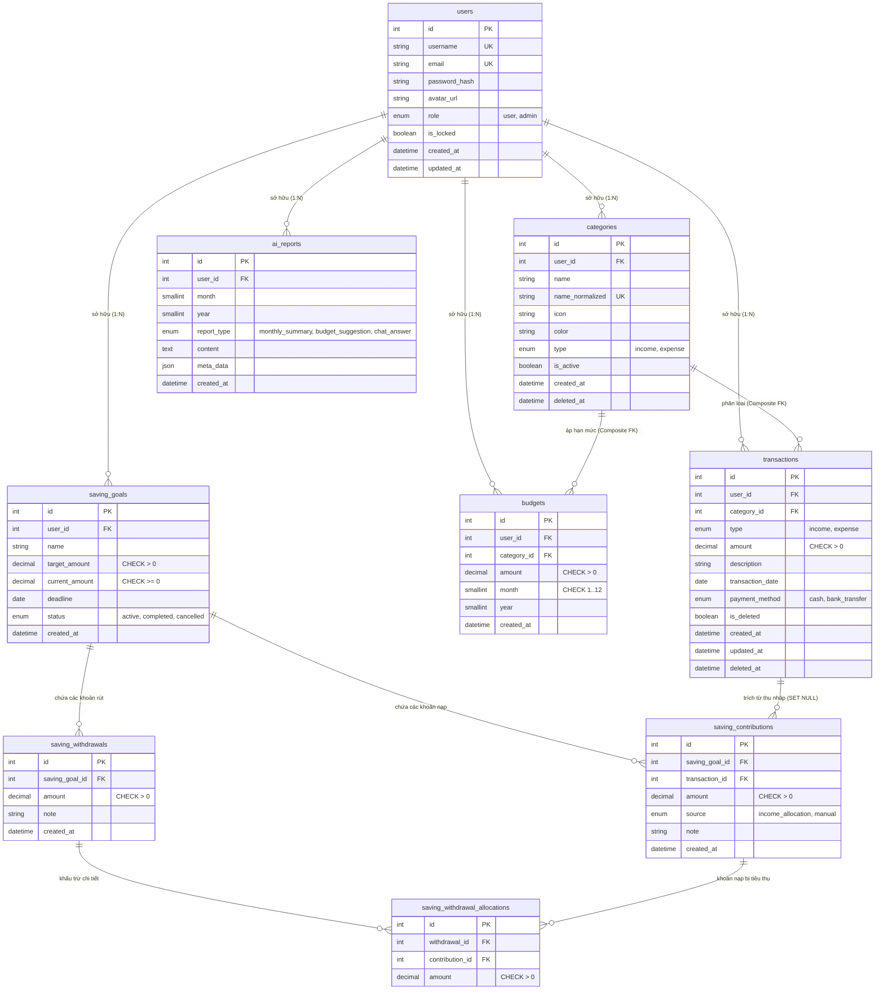
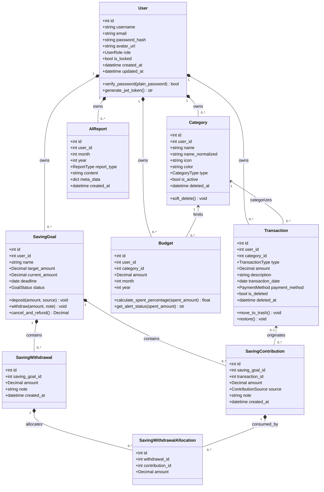

# 🗄️ THIẾT KẾ CƠ SỞ DỮ LIỆU & BIỂU ĐỒ LỚP HỆ THỐNG (DATABASE DESIGN & CLASS DIAGRAM)

> **CƠ QUAN CHỦ QUẢN**: TRƯỜNG ĐẠI HỌC CÔNG NGHỆ THÔNG TIN VÀ TRUYỀN THÔNG (ICTU) — KHOA CNTT  
> **ĐỀ TÀI**: HỆ THỐNG QUẢN LÝ CHI TIÊU CÁ NHÂN CÓ TÍCH HỢP AI (PERSONAL EXPENSE AI)  
> **NHÓM THỰC HIỆN**: NHÓM 04 (Lê Tâm An - Backend & Dương Đình Hoàng - Frontend)  
> **GIẢNG VIÊN HƯỚNG DẪN**: ThS. Nguyễn Thị Tuyển  
> **TÀI LIỆU CĂN CỨ**: [kn2.docx (Mục 3.2 & 3.3)](file:///d:/code%20vscode/presonal-expense/personal-expense-ai/kn2.docx) & [database/schema.sql](file:///d:/code%20vscode/presonal-expense/personal-expense-ai/database/schema.sql)

---

## 🏛️ 1. MÔ HÌNH THỰC THỂ QUAN HỆ (ERD - LOGICAL DATA MODEL)

Theo thiết kế tại **Mục 3.2 của [kn2.docx](file:///d:/code%20vscode/presonal-expense/personal-expense-ai/kn2.docx)**, hệ thống bao gồm 9 bảng dữ liệu được chuẩn hóa cao độ (3NF/BCNF) trên nền tảng **MySQL 8.0 InnoDB**, bảo toàn tính toàn vẹn giao dịch (ACID):



---

## 🧩 2. BIỂU ĐỒ LỚP HỆ THỐNG (CLASS DIAGRAM - MỤC 3.3 kn2.docx)

Biểu đồ lớp thể hiện cấu trúc hướng đối tượng của các thực thể nghiệp vụ (SQLAlchemy ORM Models) và mối quan hệ phương thức/thuộc tính trong hệ thống Backend FastAPI:



---

## 📖 3. TỪ ĐIỂN DỮ LIỆU CHI TIẾT (DATA DICTIONARY)

### 3.1. Bảng `users` (Tài khoản người dùng)
*Định danh và quản lý người dùng đăng nhập hệ thống.*

| Cột | Kiểu dữ liệu | Nullable | Mặc định | Khóa / Ràng buộc | Ý nghĩa nghiệp vụ |
|---|---|:---:|---|---|---|
| `id` | `INT` | No | Auto Increment | **PRIMARY KEY** | Mã định danh duy nhất |
| `username` | `VARCHAR(50)` | No | - | **UNIQUE**, INDEX | Tên người dùng |
| `email` | `VARCHAR(100)` | No | - | **UNIQUE**, INDEX | Email đăng nhập chuẩn hóa lowercase |
| `password_hash` | `VARCHAR(255)` | No | - | - | Mật khẩu băm Bcrypt/Argon2 an toàn |
| `avatar_url` | `VARCHAR(500)` | Yes | NULL | - | Đường dẫn ảnh đại diện |
| `created_at` | `DATETIME` | No | `CURRENT_TIMESTAMP` | - | Thời điểm đăng ký |
| `updated_at` | `DATETIME` | Yes | `NULL ON UPDATE` | - | Thời điểm cập nhật hồ sơ gần nhất |

---

### 3.2. Bảng `categories` (Danh mục Thu/Chi)
*Phân loại các khoản chi tiêu và nguồn thu của người dùng.*

| Cột | Kiểu dữ liệu | Nullable | Mặc định | Khóa / Ràng buộc | Ý nghĩa nghiệp vụ |
|---|---|:---:|---|---|---|
| `id` | `INT` | No | Auto Increment | **PRIMARY KEY** | Mã danh mục |
| `user_id` | `INT` | No | - | **FK** $\rightarrow$ `users(id)` | Khóa ngoại xác định quyền sở hữu |
| `name` | `VARCHAR(50)` | No | - | - | Tên hiển thị (Ăn uống, Lương...) |
| `name_normalized` | `VARCHAR(150)` | Yes | - | **UQ** `(user_id, name_normalized)` | Chống tạo 2 danh mục trùng tên |
| `icon` | `VARCHAR(30)` | No | `'other'` | - | Tên biểu tượng hiển thị trên UI |
| `color` | `VARCHAR(20)` | No | `'#6366F1'` | - | Mã màu HEX để vẽ biểu đồ SVG |
| `type` | `ENUM('income','expense')` | No | - | INDEX `(user_id, type)` | Phân loại: Thu nhập hay Chi tiêu |
| `is_active` | `BOOLEAN` | No | `TRUE` | - | Trạng thái hiển thị (TRUE: dùng; FALSE: ẩn) |
| `created_at` | `DATETIME` | No | `CURRENT_TIMESTAMP` | - | Thời điểm tạo danh mục |
| `deleted_at` | `DATETIME` | Yes | NULL | INDEX | Thời điểm xóa mềm danh mục |

---

### 3.3. Bảng `transactions` (Giao dịch thu/chi & Thùng rác)
*Bảng cốt lõi ghi nhận dòng tiền ra/vào của ví tài chính.*

| Cột | Kiểu dữ liệu | Nullable | Mặc định | Khóa / Ràng buộc | Ý nghĩa nghiệp vụ |
|---|---|:---:|---|---|---|
| `id` | `INT` | No | Auto Increment | **PRIMARY KEY** | Mã định danh giao dịch |
| `user_id` | `INT` | No | - | **FK** $\rightarrow$ `users(id)` | Người sở hữu giao dịch |
| `category_id` | `INT` | No | - | **Composite FK** | Khóa ngoại kép kiểm soát đa tầng |
| `type` | `ENUM('income','expense')` | No | - | - | Loại: Thu nhập (`income`) hoặc Chi tiêu (`expense`) |
| `amount` | `DECIMAL(15, 2)` | No | - | **CHECK** `(amount > 0)` | Số tiền giao dịch (VND) |
| `description` | `VARCHAR(255)` | Yes | NULL | - | Ghi chú / Diễn giải chi tiết giao dịch |
| `transaction_date` | `DATE` | No | - | INDEX `(user_id, date)` | Ngày phát sinh giao dịch thực tế |
| `payment_method` | `ENUM('cash','bank_transfer')` | No | `'cash'` | - | Hình thức: Tiền mặt hoặc Chuyển khoản |
| `is_deleted` | `BOOLEAN` | No | `FALSE` | INDEX `(user_id, is_deleted)` | Cờ thùng rác (TRUE: trong thùng rác) |
| `created_at` | `DATETIME` | No | `CURRENT_TIMESTAMP` | - | Thời điểm tạo bản ghi |
| `updated_at` | `DATETIME` | No | `CURRENT_TIMESTAMP` | - | Thời điểm cập nhật |
| `deleted_at` | `DATETIME` | Yes | NULL | - | Thời điểm chuyển vào thùng rác |

*Ràng buộc Composite Khóa Ngoại*:
```sql
CONSTRAINT fk_transactions_category_owner 
FOREIGN KEY (category_id, user_id) 
REFERENCES categories(id, user_id) 
ON DELETE CASCADE
```

---

### 3.4. Bảng `budgets` (Hạn mức ngân sách tháng)
*Quản lý định mức chi tiêu cho từng danh mục theo tháng.*

| Cột | Kiểu dữ liệu | Nullable | Mặc định | Khóa / Ràng buộc | Ý nghĩa nghiệp vụ |
|---|---|:---:|---|---|---|
| `id` | `INT` | No | Auto Increment | **PRIMARY KEY** | Mã ngân sách |
| `user_id` | `INT` | No | - | **FK** $\rightarrow$ `users(id)` | Người sở hữu |
| `category_id` | `INT` | No | - | **Composite FK** | Tham chiếu danh mục của chính user |
| `amount` | `DECIMAL(15, 2)` | No | - | **CHECK** `(amount > 0)` | Hạn mức chi tiêu tối đa trong tháng |
| `month` | `SMALLINT` | No | - | **CHECK** `(month BETWEEN 1 AND 12)` | Tháng áp dụng (1 - 12) |
| `year` | `SMALLINT` | No | - | INDEX `(user_id, year, month)` | Năm áp dụng |
| `created_at` | `DATETIME` | No | `CURRENT_TIMESTAMP` | - | Thời điểm thiết lập |

*Ràng buộc duy nhất*: `CONSTRAINT uq_budget_user_category_period UNIQUE (user_id, category_id, month, year)`.

---

### 3.5. Bảng `saving_goals` (Mục tiêu tiết kiệm)
*Kế hoạch tích lũy tài chính dài hạn của người dùng.*

| Cột | Kiểu dữ liệu | Nullable | Mặc định | Khóa / Ràng buộc | Ý nghĩa nghiệp vụ |
|---|---|:---:|---|---|---|
| `id` | `INT` | No | Auto Increment | **PRIMARY KEY** | Mã định danh mục tiêu |
| `user_id` | `INT` | No | - | **FK** $\rightarrow$ `users(id)` | Người sở hữu |
| `name` | `VARCHAR(100)` | No | - | - | Tên mục tiêu (Mua xe, Quỹ khẩn cấp...) |
| `target_amount` | `DECIMAL(15, 2)` | No | - | **CHECK** `(target_amount > 0)` | Số tiền kỳ vọng cần tích lũy |
| `current_amount` | `DECIMAL(15, 2)` | No | `0.00` | **CHECK** `(current_amount >= 0)` | Số tiền hiện đã nạp vào quỹ |
| `deadline` | `DATE` | Yes | NULL | - | Hạn chót hoàn thành |
| `status` | `ENUM('active','completed','cancelled')` | No | `'active'` | INDEX `(user_id, status)` | Trạng thái mục tiêu |
| `created_at` | `DATETIME` | No | `CURRENT_TIMESTAMP` | - | Thời điểm tạo mục tiêu |

---

### 3.6. Các bảng Sổ cái Tiết kiệm (Saving Ledger)
*Quản lý dòng tiền nạp và rút tiền minh bạch theo chuẩn mực ngân hàng:*

1. **`saving_contributions` (Khoản nạp)**:
   * `id` INT PK, `saving_goal_id` INT FK, `transaction_id` INT NULL FK (nguồn thu tự động), `amount` DECIMAL(15,2) CHECK > 0, `source` ENUM('income_allocation', 'manual'), `note` VARCHAR(255), `created_at` DATETIME.
2. **`saving_withdrawals` (Khoản rút)**:
   * `id` INT PK, `saving_goal_id` INT FK, `amount` DECIMAL(15,2) CHECK > 0, `note` VARCHAR(255), `created_at` DATETIME.
3. **`saving_withdrawal_allocations` (Chi tiết khấu trừ FIFO)**:
   * `id` INT PK, `withdrawal_id` INT FK, `contribution_id` INT FK, `amount` DECIMAL(15,2) CHECK > 0.
   * Ràng buộc kép: Khi rút tiền, hệ thống tự động tìm các khoản contribution cũ nhất chưa bị tiêu thụ để trừ dần (FIFO), bảo đảm tính toán chính xác số dư hoàn tiền khi một giao dịch thu nhập nguồn bị xóa.

---

### 3.7. Bảng `ai_reports`
* `ai_reports`: Lưu các bản báo cáo chi tiêu tháng do AI sinh ra (`report_type`, `prompt_sent` TEXT, `ai_response` TEXT, `user_id`, `period_month`, `period_year`). Đã được che giấu dữ liệu nhạy cảm phục vụ audit log và đối chiếu tài chính.

---

## 🔒 4. QUY TẮC AN TOÀN DÒNG TIỀN & KHÓA DÒNG CONCURRENCY

Theo Mục 4.3.2 của [kn2.docx](file:///d:/code%20vscode/presonal-expense/personal-expense-ai/kn2.docx), hệ thống đã thực nghiệm và kiểm chứng an toàn dòng tiền:

1. **Cơ chế chống âm ví khả dụng (Non-negative Balance)**:
   $$\text{Available Balance} = \sum \text{Income} - \sum \text{Expense} - \sum \text{Goal}_{\text{active/completed}} \ge 0$$
   Khi người dùng cố tình xóa một khoản thu nhập mà ví đã tiêu hết tiền, Backend bắt buộc chặn lại và trả về mã lỗi **`400 Bad Request`** kèm thông báo: *"Không thể xóa nguồn thu vì thao tác này sẽ làm số dư khả dụng bị âm."*, ứng dụng không bị crash.
2. **Khóa bi quan (Pessimistic Locking)**:
   Mọi endpoint thay đổi dòng tiền đều thực hiện khóa hàng người dùng trước bằng câu lệnh:
   ```sql
   SELECT id FROM users WHERE id = :user_id FOR UPDATE;
   ```
3. **Thứ tự khóa chống Deadlock**:
   Luôn khóa hàng bảng `users` trước, sau đó mới khóa hàng bảng `saving_goals` khi thực hiện các nghiệp vụ nạp/rút liên quan đến quỹ tiết kiệm.

---

## 🚀 5. KIỂM THỬ MIGRATION & DỮ LIỆU MẪU DEMO

Theo Mục 4.3.2 của [kn2.docx](file:///d:/code%20vscode/presonal-expense/personal-expense-ai/kn2.docx):
* **Script khởi tạo dữ liệu mẫu**: Chạy script [database/seed_demo.py](file:///d:/code%20vscode/presonal-expense/personal-expense-ai/database/seed_demo.py) nạp thành công tài khoản `demo@example.com` (mật khẩu: `demo123456`) với **74 giao dịch demo trải dài 6 tháng** thực tế, giúp giảng viên và người dùng trải nghiệm ngay lập tức các biểu đồ xu hướng và tính năng AI sinh báo cáo.
* **Bộ test tự động**: 222/222 test cases vượt qua hoàn hảo (bao gồm 165 backend + 57 frontend, kèm các test case kiểm tra migration an toàn trên MySQL cô lập).
