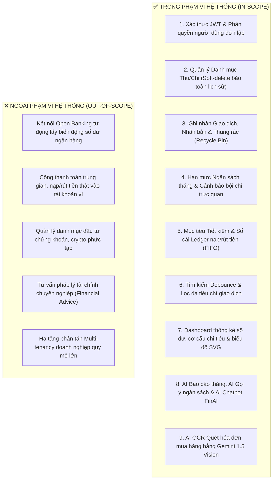
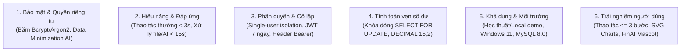

# 📋 ĐẶC TẢ YÊU CẦU PHẦN MỀM (SOFTWARE REQUIREMENTS SPECIFICATION - SRS)

> **CƠ QUAN CHỦ QUẢN**: TRƯỜNG ĐẠI HỌC CÔNG NGHỆ THÔNG TIN VÀ TRUYỀN THÔNG (ICTU) — KHOA CÔNG NGHỆ THÔNG TIN  
> **HỌC PHẦN**: Ứng dụng Trí tuệ Nhân tạo | **HỌC KỲ**: Năm học 2025 - 2026  
> **ĐỀ TÀI**: HỆ THỐNG QUẢN LÝ CHI TIÊU CÁ NHÂN CÓ TÍCH HỢP AI (PERSONAL EXPENSE AI)  
> **NHÓM THỰC HIỆN**: NHÓM 04  
> 1. **Lê Tâm An** — Vai trò: Kỹ sư Backend, Kiến trúc CSDL & Tích hợp Dịch vụ AI  
> 2. **Dương Đình Hoàng** — Vai trò: Kỹ sư Frontend, Thiết kế UI/UX & Tối ưu Trải nghiệm  
> **GIẢNG VIÊN HƯỚNG DẪN**: ThS. Nguyễn Thị Tuyển  
> **TÀI LIỆU CĂN CỨ**: [REQUIREMENTS.md](file:///d:/code%20vscode/presonal-expense/personal-expense-ai/REQUIREMENTS.md) & [kn2.docx](file:///d:/code%20vscode/presonal-expense/personal-expense-ai/kn2.docx)

---

## 🧭 1. KHẢO SÁT HIỆN TRẠNG & TỔNG QUAN HỆ THỐNG

### 1.1. Bối cảnh đề tài
Quản lý tài chính cá nhân là kỹ năng thiết yếu đối với sinh viên, người đi làm và các hộ gia đình. Tuy nhiên, phần lớn người dùng hiện nay vẫn theo dõi thu chi theo cách thủ công như ghi sổ tay, dùng bảng tính Excel hoặc nhớ theo kinh nghiệm cá nhân. Cách tiếp cận này bộc lộ nhiều nhược điểm:
* Dễ bỏ sót giao dịch, mất nhiều thời gian tổng hợp số liệu.
* Không có cơ chế cảnh báo khi chi tiêu sắp vượt ngưỡng ngân sách.
* Rất khó nhìn ra thói quen chi tiêu dài hạn hoặc nhận diện các khoản chi lãng phí.

Theo nghiên cứu tổng hợp từ 21 bài báo khoa học của **Richardi-Cuba và cộng sự (2024)**, hai rào cản lớn nhất khiến người dùng phổ thông bỏ dở các ứng dụng tài chính thương mại (như Money Lover, MISA, Spendee) là:
1. **Lo ngại về bảo mật dữ liệu riêng tư** (khi ứng dụng đòi hỏi quyền truy cập tài khoản ngân hàng hoặc lưu trữ quá nhiều dữ liệu nhạy cảm).
2. **Thiếu kiến thức tài chính cơ bản** và thiếu công cụ tương tác bằng ngôn ngữ tự nhiên để giải đáp thắc mắc tài chính một cách gần gũi, dễ hiểu. Đa số các tính năng phân tích chuyên sâu trên thị trường đều bị khóa sau gói trả phí (Premium).

### 1.2. Mục tiêu của hệ thống
Hệ thống **Personal Expense AI** được xây dựng nhằm giải quyết triệt để các rào cản trên với các mục tiêu cốt lõi:
1. **Ghi chép & Phân loại minh bạch**: Quản lý đầy đủ các giao dịch thu/chi, danh mục tùy biến, ngân sách tháng và mục tiêu tiết kiệm dài hạn.
2. **Tích hợp Trí tuệ Nhân tạo (Gemini API)**: Tự động sinh báo cáo tháng, gợi ý hạn mức ngân sách thông minh (quy tắc 50/30/20), trả lời câu hỏi tài chính qua trợ lý ảo FinAI và tự động nhận diện hóa đơn bằng thị giác máy tính (AI OCR).
3. **Bảo vệ quyền riêng tư tuyệt đối (Data Privacy)**: Áp dụng nguyên tắc **Data Minimization** — chỉ gửi dữ liệu số học đã tổng hợp sang AI, tuyệt đối không gửi danh tính hay thông tin tài khoản cá nhân.
4. **Vận hành an toàn & Toàn vẹn luồng tiền**: Bất biến số dư khả dụng không bao giờ bị âm ($\ge 0$), ngăn chặn Race-condition bằng cơ chế khóa dòng bi quan (`SELECT ... FOR UPDATE`).

---

## 🎯 2. PHẠM VI DỰ ÁN (PROJECT SCOPE)

Tuân thủ nghiêm ngặt giới hạn tính năng tại [REQUIREMENTS.md](file:///d:/code%20vscode/presonal-expense/personal-expense-ai/REQUIREMENTS.md) và Báo cáo đề tài [kn2.docx](file:///d:/code%20vscode/presonal-expense/personal-expense-ai/kn2.docx):

---

## 🗃️ 3. DỮ LIỆU CẦN QUẢN LÝ (DATA DOMAIN)

Theo khảo sát tại Mục 2.1.3 của `kn2.docx`, hệ thống quản lý 6 nhóm dữ liệu chính:

1. **Thông tin người dùng**: Tài khoản đăng nhập (`username`, `email`), mật khẩu băm bảo mật (`password_hash`), ảnh đại diện (`avatar_url`), ngày tạo và cập nhật.
2. **Lịch sử giao dịch**: Các khoản thu nhập và chi tiêu phát sinh hàng ngày gồm: số tiền (`amount`), ngày giao dịch (`transaction_date`), danh mục (`category_id`), hình thức thanh toán (`payment_method`: Tiền mặt / Chuyển khoản), ghi chú diễn giải (`description`), trạng thái thùng rác (`is_deleted`, `deleted_at`).
3. **Hạn mức ngân sách**: Định mức chi tiêu tối đa theo tháng và theo danh mục do người dùng thiết lập (`amount`, `month`, `year`, `category_id`) phục vụ cảnh báo trực quan.
4. **Mục tiêu tiết kiệm**: Kế hoạch tài chính dài hạn gồm tên mục tiêu, số tiền kỳ vọng (`target_amount`), số tiền hiện có (`current_amount`), hạn chót (`deadline`), trạng thái và sổ cái đối soát lịch sử nạp tiền (`saving_contributions`), rút tiền (`saving_withdrawals`), phân bổ tiêu thụ FIFO (`saving_withdrawal_allocations`).
5. **Danh mục thu và chi**: Tập danh mục mặc định hệ thống tự khởi tạo (Ăn uống, Đi lại, Lương...) và danh mục tùy chỉnh cá nhân hóa của từng người dùng (`name`, `name_normalized`, `type`, `icon`, `color`, `is_active`, `deleted_at`).
6. **Lịch sử báo cáo & Tương tác AI**: Lưu trữ các bài báo cáo chi tiêu tháng (`ai_reports`), gợi ý ngân sách và ngữ cảnh tóm tắt phục vụ trợ lý ảo FinAI.

---

## ⚙️ 4. YÊU CẦU CHỨC NĂNG CHI TIẾT (FUNCTIONAL REQUIREMENTS - FR)

Chuẩn hóa 11 chức năng quản lý và 4 chức năng AI theo cấu trúc chuẩn mực kỹ thuật **[Đầu vào $\rightarrow$ Xử lý $\rightarrow$ Đầu ra]** bám sát Mục 2.2 của Báo cáo [kn2.docx](file:///d:/code%20vscode/presonal-expense/personal-expense-ai/kn2.docx):

### 4.1. Nhóm chức năng Quản lý Tài chính (Management Modules)

#### FR01. Chức năng Đăng ký tài khoản
* **Đầu vào**: Tên đăng nhập (`username`), email (`email`), mật khẩu (`password`).
* **Xử lý**: Kiểm tra định dạng email và mật khẩu tối thiểu 6 ký tự. Kiểm tra trùng lặp email và username trong CSDL. Băm mật khẩu bằng thuật toán Bcrypt/Argon2. Tạo bản ghi mới trong bảng `users` và tự động kích hoạt bộ danh mục thu/chi mặc định.
* **Đầu ra**: Tài khoản được tạo thành công, thông báo phản hồi và điều hướng sang trang Đăng nhập.

#### FR02. Chức năng Đăng nhập & Xác thực
* **Đầu vào**: Tên đăng nhập hoặc email, mật khẩu.
* **Xử lý**: Đối chiếu thông tin với cơ sở dữ liệu. Nếu khớp, hệ thống tạo JWT Token (HS256) chứa `sub` (User ID) và thời hạn truy cập (mặc định 7 ngày cho phiên bản học thuật).
* **Đầu ra**: Trả về `access_token` và thông tin người dùng; Frontend lưu vào `localStorage` và chuyển hướng vào màn hình Dashboard.

#### FR03. Chức năng Quản lý tài khoản cá nhân
* **Đầu vào**: Thông tin cá nhân mới (ảnh đại diện `avatar_url`, mật khẩu cũ và mật khẩu mới khi đổi mật khẩu).
* **Xử lý**: Kiểm tra mật khẩu cũ hợp lệ (nếu đổi mật khẩu); cập nhật thông tin tương ứng vào cơ sở dữ liệu của người dùng đang đăng nhập.
* **Đầu ra**: Thông tin hồ sơ hiển thị được làm mới tức thì trên thanh điều hướng.

#### FR04. Chức năng Quản lý danh mục thu/chi
* **Đầu vào**: Tên danh mục, loại danh mục (`income` hoặc `expense`), biểu tượng icon, mã màu hex.
* **Xử lý**: Chuẩn hóa tên chữ thường (`name_normalized`) để kiểm tra chống trùng tên trong cùng một tài khoản. Gán `user_id` sở hữu. Hỗ trợ thao tác Ẩn/Hiện (`is_active`) và Xóa mềm (`deleted_at = NOW()`).
* **Đầu ra**: Danh mục mới xuất hiện trong danh sách để sẵn sàng sử dụng khi nhập giao dịch.

#### FR05. Chức năng Ghi nhận giao dịch thu/chi & Nhân bản
* **Đầu vào**: Số tiền (`amount > 0`), ngày giao dịch, danh mục, ghi chú, phương thức thanh toán (`cash`/`bank_transfer`). Hỗ trợ nhập tay, nhân bản từ giao dịch có sẵn (Duplicate) hoặc chụp ảnh hóa đơn (AI OCR).
* **Xử lý**: Thực thi trong Database Transaction: Khóa dòng người dùng (`SELECT ... FOR UPDATE`), kiểm tra tính hợp lệ và bất biến số dư (nếu là khoản chi thì số dư khả dụng phải đủ bù đắp), lưu trữ bản ghi vào bảng `transactions`, tự động cập nhật số dư ví khả dụng.
* **Đầu ra**: Giao dịch hiển thị trên bảng lịch sử chi tiêu và số dư tài khoản thay đổi chính xác.

#### FR06. Chức năng Thùng rác & Khôi phục giao dịch (Recycle Bin)
* **Đầu vào**: ID giao dịch cần chuyển thùng rác / khôi phục / xóa vĩnh viễn.
* **Xử lý**:
  * *Chuyển vào thùng rác*: Đặt `is_deleted = true`, ghi nhận `deleted_at`. Nếu là khoản thu, kiểm tra số dư dự kiến không được âm sau khi đã cộng phần tiền tiết kiệm được hoàn trả (`released_savings`).
  * *Khôi phục*: Đặt `is_deleted = false`, `deleted_at = NULL` sau khi kiểm tra số dư đáp ứng.
  * *Xóa vĩnh viễn*: Chỉ cho phép xóa khi giao dịch đã nằm trong thùng rác; giải phóng liên kết `saving_contributions` trước khi xóa cứng.
* **Đầu ra**: Trạng thái giao dịch và số dư khả dụng được đồng bộ nhất quán.

#### FR07. Chức năng Tìm kiếm giao dịch
* **Đầu vào**: Từ khóa tìm kiếm do người dùng nhập.
* **Xử lý**: Áp dụng kỹ thuật Debounce (300ms) ở Frontend; Backend truy vấn tìm kiếm gần đúng (`LIKE %keyword%`) trên trường ghi chú (`description`) của các giao dịch chưa bị xóa của user.
* **Đầu ra**: Danh sách các giao dịch khớp với từ khóa tìm kiếm hiển thị tức thì.

#### FR08. Chức năng Lọc giao dịch nâng cao
* **Đầu vào**: Tiêu chí lọc gồm: khoảng thời gian (từ ngày - đến ngày), danh mục, loại thu hoặc chi, phương thức thanh toán, thứ tự sắp xếp (ngày, số tiền).
* **Xử lý**: Xây dựng câu truy vấn SQL động với các mệnh đề `WHERE` kết hợp chỉ mục `(user_id, transaction_date)`.
* **Đầu ra**: Danh sách giao dịch được phân trang và thỏa mãn chính xác các tiêu chí lọc.

#### FR09. Chức năng Thiết lập ngân sách tháng
* **Đầu vào**: Số tiền hạn mức (`amount > 0`), tháng áp dụng (1-12), năm, danh mục chi tiêu.
* **Xử lý**: Kiểm tra ràng buộc duy nhất `(user_id, category_id, month, year)`; nếu đã tồn tại thì cập nhật hạn mức, nếu chưa thì tạo bản ghi mới trong bảng `budgets`.
* **Đầu ra**: Ghi nhận ngân sách thành công, hiển thị thanh tiến độ theo dõi.

#### FR10. Chức năng Giám sát & Cảnh báo vượt ngân sách
* **Đầu vào**: Dữ liệu giao dịch chi tiêu thực tế trong tháng và hạn mức ngân sách hiện có.
* **Xử lý**: Tự động tính tỷ lệ phần trăm: $\text{Tỷ lệ} = (\text{Tổng chi danh mục} / \text{Hạn mức}) \times 100\%$.
* **Đầu ra**: Hiển thị trực quan: Màu xanh lá (< 80%), Màu vàng cam cảnh báo (80% - 100%), Màu đỏ báo động bội chi (> 100%) kèm số tiền chi vượt ngưỡng.

#### FR11. Chức năng Quản lý mục tiêu tiết kiệm & Sổ cái nạp/rút
* **Đầu vào**: Tên mục tiêu, số tiền kỳ vọng (`target_amount`), hạn chót, số tiền nạp thêm hoặc số tiền muốn rút khỏi quỹ.
* **Xử lý**:
  * *Nạp tiền*: Khóa dòng người dùng, trừ số dư khả dụng ví, tăng `current_amount`, ghi nhận bản ghi `saving_contributions`.
  * *Rút tiền*: Kiểm tra số tiền rút $\le$ số dư hiện có trong quỹ, ghi nhận `saving_withdrawals`, phân bổ khấu trừ vào các khoản contribution theo thuật toán FIFO (`saving_withdrawal_allocations`), hoàn trả tiền về số dư khả dụng của ví.
* **Đầu ra**: Cập nhật tiến độ phần trăm hoàn thành mục tiêu và lịch sử giao dịch sổ cái chi tiết.

#### FR12. Chức năng Thống kê chi tiêu & Biểu đồ trực quan (Dashboard)
* **Đầu vào**: Yêu cầu xem báo cáo theo tháng cụ thể hoặc chu kỳ (3, 6, 12 tháng).
* **Xử lý**: Tính tổng thu, tổng chi, số tiền tích lũy trong các quỹ tiết kiệm active/completed, số dư khả dụng thực tế. Phân nhóm theo danh mục.
* **Đầu ra**: Thẻ chỉ số tài chính (Metric Cards), biểu đồ phân bổ hình tròn/Donut và biểu đồ cột so sánh thu/chi được vẽ bằng SVG tùy biến trực quan.

---

### 4.2. Nhóm chức năng Trí tuệ Nhân tạo (AI Features)

#### FR13. Chức năng AI sinh báo cáo tài chính tháng
* **Đầu vào**: Dữ liệu tài chính tháng đã tổng hợp sạch (Tổng thu, tổng chi, danh sách số tiền theo danh mục, top 1 chi tiêu cao nhất).
* **Xử lý**: Đưa số liệu vào System Prompt và User Prompt chuẩn 5 thành phần, gửi đến Google Gemini API (gemini-1.5-flash). Mô hình suy luận và đánh giá thói quen tiêu dùng.
* **Đầu ra**: Báo cáo văn bản thuần túy (khoảng 100–150 từ), chỉ rõ khoản chi lớn nhất, nhận xét xu hướng và 1–3 gợi ý điều chỉnh cụ thể.

#### FR14. Chức năng AI gợi ý ngân sách thông minh
* **Đầu vào**: Lịch sử chi tiêu 3 đến 6 tháng gần nhất theo từng danh mục.
* **Xử lý**: AI phân tích mức độ biến thiên chi tiêu, kết hợp nguyên tắc phân bổ tài chính 50/30/20 để tính toán hạn mức khuyến nghị cho tháng tiếp theo. Bắt buộc trả về định dạng chuẩn JSON Schema.
* **Đầu ra**: Bảng hạn mức ngân sách đề xuất cho từng danh mục để người dùng xem trước và áp dụng chỉ với 1 cú click.

#### FR15. Chức năng AI Trợ lý Chatbot (FinAI Mascot 3D)
* **Đầu vào**: Câu hỏi tự nhiên của người dùng (ví dụ: *"Tháng này tôi tiêu nhiều nhất vào đâu?"*, *"Làm sao tiết kiệm thêm 2 triệu?"*) hoặc các nút bấm Quick Prompt Chips.
* **Xử lý**: Hệ thống đính kèm ngữ cảnh tài chính tóm tắt của tháng hiện tại và 10 giao dịch gần nhất vào System Prompt của Gemini; giới hạn token phản hồi (< 500 tokens).
* **Đầu ra**: Câu trả lời chat súc tích, bằng tiếng Việt, đi thẳng vào số liệu thực tế của người dùng, không bịa đặt số liệu.

#### FR16. Chức năng AI OCR Quét hóa đơn (Gemini Vision)
* **Đầu vào**: File ảnh chụp hóa đơn mua sắm hoặc biên lai chuyển khoản (JPG, PNG, WEBP).
* **Xử lý**: Chuyển đổi ảnh sang Base64, gửi tới mô hình đa phương thức Gemini 1.5 Flash Vision kèm System Prompt trích xuất JSON. Backend lọc dữ liệu bằng Regex để làm sạch chuỗi và ánh xạ vào danh mục hệ thống.
* **Đầu ra**: Tự động trích xuất và điền sẵn vào Form giao dịch: Số tiền thanh toán (`amount`), Ngày phát sinh (`transaction_date`), Tên người bán (`description`) và Gợi ý danh mục phù hợp.

---

### 4.3. Nhóm chức năng Quản trị hệ thống (Administrative Modules)

#### FR17. Chức năng Quản lý tài khoản & Khắc phục sự cố người dùng
* **Đầu vào**: Bộ lọc tìm kiếm username/email, trạng thái tài khoản (Tất cả / Hoạt động / Bị khóa), ID người dùng cần xử lý.
* **Xử lý**: Hệ thống xác thực quyền Quản trị viên (`require_admin`). Cho phép chuyển đổi cờ `is_locked` (Khóa/Mở khóa tài khoản) và hỗ trợ tạo mật khẩu tạm thời ngẫu nhiên an toàn (`Reset@xxxx`) khi người dùng mất quyền truy cập. Áp dụng quy tắc ngăn chặn Admin tự khóa chính mình.
* **Đầu ra**: Trạng thái tài khoản được cập nhật tức thì; cung cấp mật khẩu tạm thời để gửi cho người dùng.

#### FR18. Chức năng Giám sát tài nguyên hệ thống và AI Telemetry
* **Đầu vào**: Yêu cầu tra cứu số liệu thống kê hệ thống từ Quản trị viên.
* **Xử lý**: Tổng hợp số lượng người dùng (tổng, hoạt động, bị khóa), tổng số bản ghi giao dịch, và số lượt gọi AI Gemini từ bảng `ai_reports` phân nhóm theo loại tác vụ (`monthly_summary`, `budget_suggestion`, `chat_answer`).
* **Đầu ra**: Dashboard trực quan hiển thị các thẻ chỉ số và cơ cấu sử dụng AI giúp kiểm soát chi phí token API và chống hành vi spam chatbot.

---

## 🛡️ 5. YÊU CẦU PHI CHỨC NĂNG (NON-FUNCTIONAL REQUIREMENTS - NFR)

Bám sát chặt chẽ Mục 2.2.4 của Báo cáo [kn2.docx](file:///d:/code%20vscode/presonal-expense/personal-expense-ai/kn2.docx):

### NFR1: Bảo mật và quyền riêng tư về dữ liệu (Security & Privacy)
* Mật khẩu người dùng bắt buộc phải băm bằng thuật toán an toàn một chiều (Bcrypt / Argon2) để chống dịch ngược.
* **Nguyên tắc ẩn danh hóa khi gửi sang AI**: Toàn bộ dữ liệu trước khi gửi sang Google Gemini API đều phải loại bỏ thông tin định danh cá nhân (tên, email, số tài khoản, số điện thoại). AI chỉ nhận các con số tổng hợp theo danh mục.

### NFR2: Hiệu năng hệ thống (Performance)
* Các thao tác CRUD người dùng thông thường (thêm giao dịch, lọc danh mục, xem số dư) có thời gian phản hồi dưới **3 giây** (thực tế backend FastAPI xử lý $\le 200\text{ ms}$).
* Các thao tác xử lý như gọi AI Vision phân tích ảnh hóa đơn có thời gian phản hồi dưới **15 giây** (thực tế OCR Gemini phản hồi trong 2–4 giây).

### NFR3: Phân quyền và cô lập dữ liệu (Authorization & RBAC)
* Hệ thống vận hành theo mô hình phân quyền RBAC phân cấp 2 vai trò: **Người dùng cá nhân (`user`)** và **Quản trị viên (`admin`)**.
* Người dùng cá nhân tuân thủ mô hình cô lập dữ liệu tuyệt đối (Single-user data isolation): Mỗi người dùng chỉ đọc và thao tác trên dữ liệu tài chính của chính mình.
* Quản trị viên chỉ có quyền quản trị vòng đời tài khoản và giám sát tài nguyên gọi AI; tuyệt đối không có quyền xem hay can thiệp vào các giao dịch, số dư riêng tư của người dùng (nguyên tắc Zero-Knowledge Privacy).
* Toàn bộ các API nghiệp vụ đều yêu cầu mã JWT Token hợp lệ trong HTTP Header `Authorization: Bearer <token>`; token hết hạn hệ thống tự động điều hướng về màn hình đăng nhập.

### NFR4: Tính toàn vẹn số dư & Luồng tiền (Financial Integrity)
* Bất biến số dư khả dụng: $\text{Available Balance} \ge 0$ trong mọi thời điểm.
* Sử dụng cơ chế khóa dòng bi quan `SELECT ... FOR UPDATE` trên bảng `users` để tuần tự hóa các giao dịch đồng thời (chống Race-condition khi người dùng click liên tục).
* Số tiền lưu trữ trong CSDL và tính toán ở tầng Backend dùng kiểu `DECIMAL(15, 2)` / `Python Decimal`, loại bỏ triệt để sai số làm tròn số thực `float`.

### NFR5: Tính khả dụng & Môi trường triển khai (Availability & Environment)
* Hệ thống được thiết kế để chạy ổn định trong môi trường máy chủ cục bộ phục vụ mục đích học thuật, nghiệm thu và đánh giá đề tài tốt nghiệp/môn học.
* Môi trường thử nghiệm chuẩn: Máy tính cá nhân chạy Windows 11, kết nối MySQL 8.0 local và gọi Gemini API qua mạng Internet.

### NFR6: Trải nghiệm người dùng (UX / Usability)
* Giao diện trực quan, thân thiện, không đòi hỏi người dùng phải đọc tài liệu hướng dẫn trước khi sử dụng.
* Các thao tác thường gặp như thêm giao dịch, xem báo cáo thống kê phải thực hiện được trong **tối đa 3 bước bấm**.
* Biểu đồ trực quan vẽ bằng SVG tùy biến, sắc nét, không phụ thuộc vào thư viện bên ngoài cồng kềnh.
* Hệ thống luôn có Toast/Modal thông báo phản hồi rõ ràng sau mỗi hành động thành công hoặc thất bại.

---

## 💻 6. YÊU CẦU CÔNG NGHỆ VÀ MÔI TRƯỜNG PHÁT TRIỂN

Theo bảng công nghệ quy định tại Chương 1 và Mục 4.1 của [kn2.docx](file:///d:/code%20vscode/presonal-expense/personal-expense-ai/kn2.docx):

| Phân hệ | Công nghệ sử dụng | Phiên bản | Vai trò & Lý do lựa chọn |
|---|---|---|---|
| **Backend API** | **FastAPI (Python)** | 0.115+ (Python 3.11) | Hiệu năng cao trên nền ASGI, tự động sinh tài liệu Swagger/OpenAPI, xác thực Pydantic mạnh mẽ, Dependency Injection gọn gàng. |
| **Frontend UI** | **React & Vite** | React 19, Vite 8 | Xây dựng giao diện theo mô hình Component tái sử dụng cao, Virtual DOM mượt mà, vẽ biểu đồ SVG tùy biến sắc nét. |
| **Cơ sở dữ liệu** | **MySQL Server** | MySQL 8.0 (InnoDB) | Đảm bảo tính toàn vẹn giao dịch ACID, hỗ trợ khóa dòng `FOR UPDATE`, hỗ trợ ràng buộc Composite Foreign Key và Check Constraints. |
| **Mô hình AI** | **Google Gemini API** | gemini-1.5-flash / vision | Xử lý ngôn ngữ tự nhiên tiếng Việt xuất sắc, hỗ trợ thị giác máy tính OCR hóa đơn, thời gian phản hồi nhanh và chi phí token tối ưu. |
| **Quản lý mã nguồn** | **Git & GitHub** | - | Quản lý phiên bản mã nguồn phân tán, phân chia nhánh và theo dõi lịch sử commit của các thành viên. |
