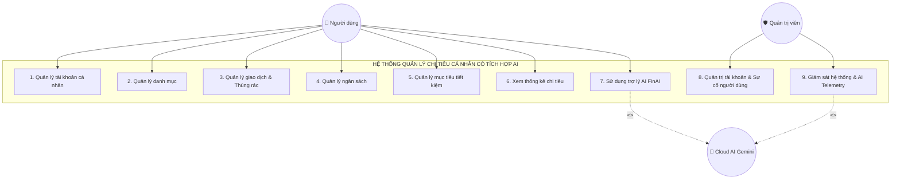
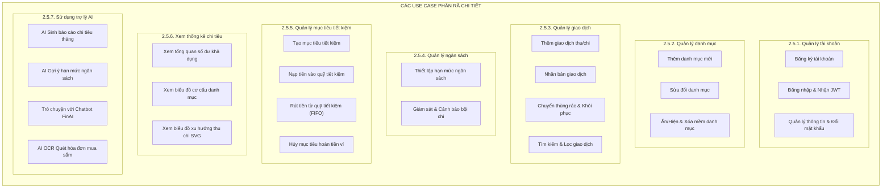
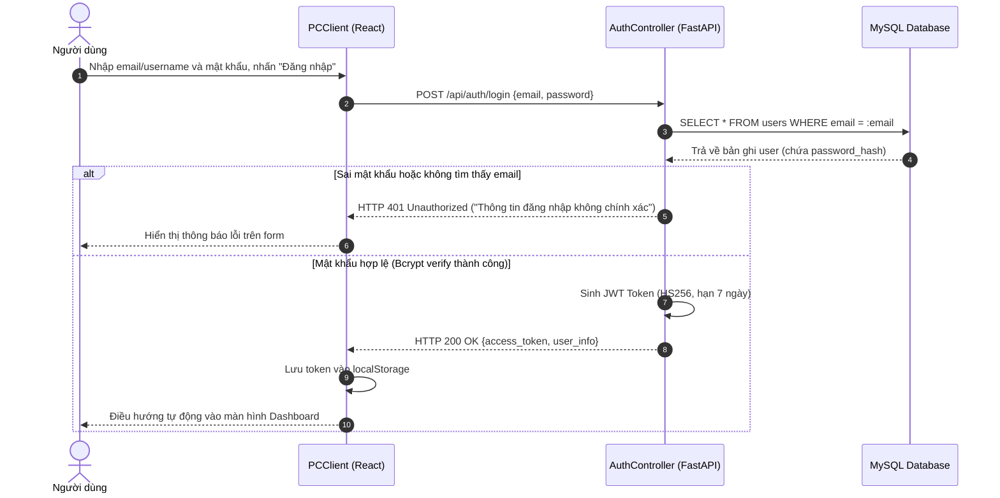
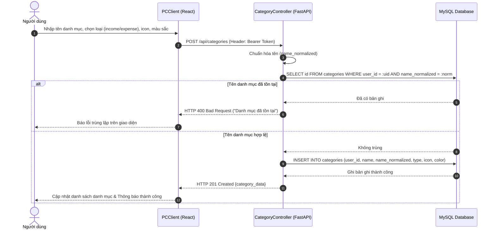
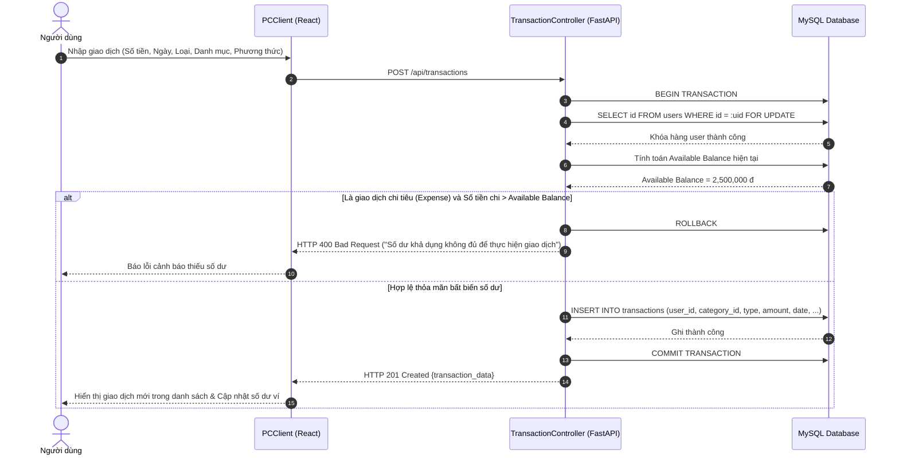
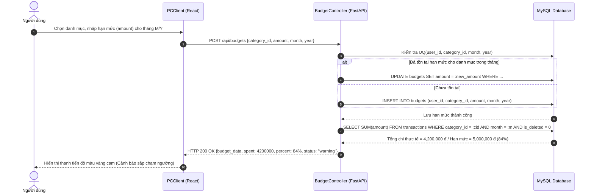
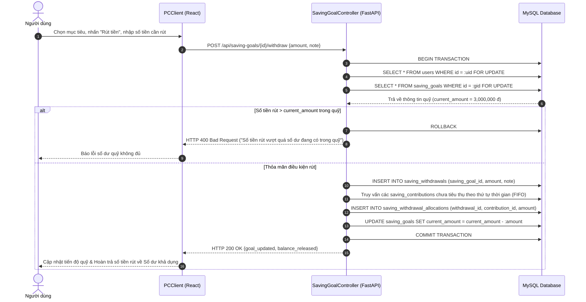
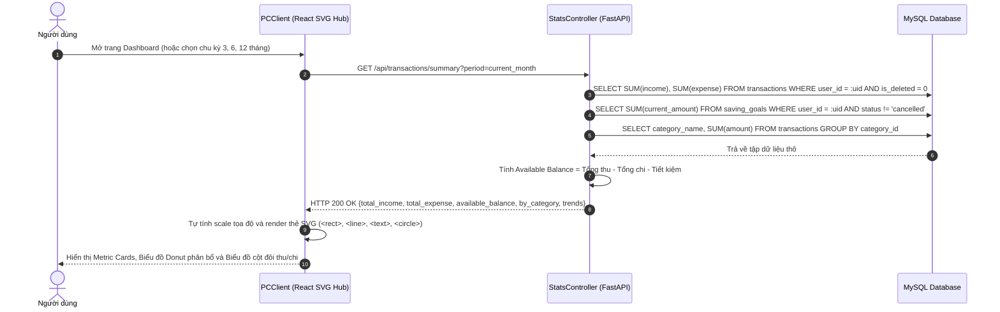
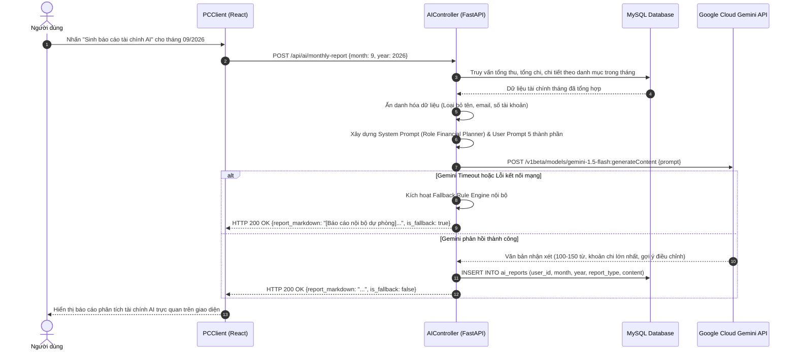
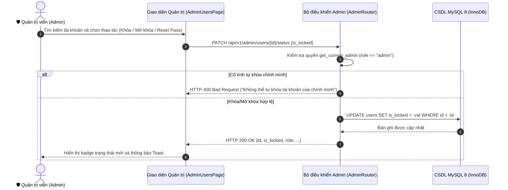

# 📖 ĐẶC TẢ USE CASE & BIỂU ĐỒ TRÌNH TỰ HỆ THỐNG (USE CASE SPECIFICATION)

> **CƠ QUAN CHỦ QUẢN**: TRƯỜNG ĐẠI HỌC CÔNG NGHỆ THÔNG TIN VÀ TRUYỀN THÔNG (ICTU) — KHOA CNTT  
> **ĐỀ TÀI**: HỆ THỐNG QUẢN LÝ CHI TIÊU CÁ NHÂN CÓ TÍCH HỢP AI (PERSONAL EXPENSE AI)  
> **NHÓM THỰC HIỆN**: NHÓM 04 (Lê Tâm An - Backend & Dương Đình Hoàng - Frontend)  
> **GIẢNG VIÊN HƯỚNG DẪN**: ThS. Nguyễn Thị Tuyển  
> **TÀI LIỆU CĂN CỨ**: [REQUIREMENTS.md](file:///d:/code%20vscode/presonal-expense/personal-expense-ai/REQUIREMENTS.md), [kn2.docx](file:///d:/code%20vscode/presonal-expense/personal-expense-ai/kn2.docx) và [docs/requirements.md](file:///d:/code%20vscode/presonal-expense/personal-expense-ai/docs/requirements.md)

---

## 👥 1. XÁC ĐỊNH TÁC NHÂN HỆ THỐNG (ACTORS)

Theo Mục 2.3 của [kn2.docx](file:///d:/code%20vscode/presonal-expense/personal-expense-ai/kn2.docx), hệ thống tương tác với các tác nhân sau:

| Tác nhân (Actor) | Phân loại | Vai trò & Trách nhiệm trong hệ thống |
|---|---|---|
| **Người dùng cá nhân (End User)** | Tác nhân chính (Primary Actor) | Là người đã đăng nhập, trực tiếp nhập liệu thu chi, thiết lập ngân sách, nạp/rút tiền tiết kiệm, xem báo cáo trực quan và đặt câu hỏi cho trợ lý AI. |
| **Quản trị viên hệ thống (Administrator)** | Tác nhân quản trị (Administrative Actor) | Quản trị tài khoản người dùng, xử lý sự cố đăng nhập/khóa tài khoản, cấp lại mật khẩu tạm thời và giám sát tài nguyên gọi AI Gemini (theo chuẩn Zero-Knowledge không xem chi tiết chi tiêu riêng tư). |
| **Dịch vụ AI Đám mây (Cloud AI / Gemini)** | Tác nhân hỗ trợ (Secondary Actor) | Cung cấp dịch vụ mô hình ngôn ngữ lớn (LLM) và thị giác máy tính: phân tích thói quen, gợi ý ngân sách, trả lời câu hỏi chat và OCR hóa đơn. |
| **Hệ thống Máy chủ (PCServer / Backend)** | Tác nhân hệ thống | Tiếp nhận yêu cầu, xác thực JWT, kiểm soát giao dịch ACID, khóa dòng bi quan (`SELECT ... FOR UPDATE`) và ẩn danh hóa dữ liệu trước khi gửi sang AI. |

---

## 🗺️ 2. BIỂU ĐỒ USE CASE TỔNG QUÁT & PHÂN RÃ

### 2.1. Biểu đồ Use Case Tổng quát (Mục 2.4 kn2.docx)



---

### 2.2. Biểu đồ Use Case Phân rã 7 Phân hệ (Mục 2.5 kn2.docx)



---

## 🔄 3. BIỂU ĐỒ TRÌNH TỰ TIÊU BIỂU (SEQUENCE DIAGRAMS)

Theo quy định tại **Mục 3.1 của [kn2.docx](file:///d:/code%20vscode/presonal-expense/personal-expense-ai/kn2.docx)**, hệ thống được nhóm thành các nhóm nghiệp vụ chính và lựa chọn các biểu đồ trình tự tiêu biểu nhất cho từng nhóm:

### 3.1.1. Nhóm Xác thực tài khoản (Đăng nhập hệ thống)
*Người dùng nhập thông tin qua Form, Controller kiểm tra tính hợp lệ và truy vấn CSDL; nếu đúng mật khẩu, hệ thống tạo Access Token và chuyển hướng vào Dashboard, ngược lại sẽ báo lỗi.*



---

### 3.1.2. Nhóm Quản lý danh mục (Thêm mới & Cập nhật danh mục)
*Người dùng nhập thông tin danh mục mới; Controller kiểm tra tính hợp lệ rồi gửi lệnh INSERT lưu vào bảng categories trong CSDL và hiển thị thông báo thành công.*



---

### 3.1.3. Nhóm Giao dịch và Khôi phục (Thêm giao dịch & Kiểm soát số dư)
*Khi người dùng mở form, hệ thống truy vấn CSDL để lấy danh mục; người dùng điền thông tin, Controller kiểm tra an toàn số dư và thực thi INSERT INTO transactions.*



---

### 3.1.4. Nhóm Ngân sách (Thiết lập & Cảnh báo bội chi)
*Người dùng nhập hạn mức và tháng áp dụng, Controller kiểm tra tính hợp lệ rồi lưu vào bảng budgets; tự động đối chiếu tổng chi với hạn mức để kích hoạt cảnh báo.*



---

### 3.1.5. Nhóm Mục tiêu tiết kiệm (Nạp tiền & Rút tiền có sổ Ledger FIFO)
*Nạp tiền: INSERT vào saving_contributions và UPDATE saving_goals. Rút tiền: Kiểm tra số dư quỹ, ghi saving_withdrawals và phân bổ khấu trừ FIFO vào saving_withdrawal_allocations.*



---

### 3.1.6. Nhóm Thống kê chi tiêu & Biểu đồ SVG
*Khi người dùng truy cập trang tổng quan, Controller truy vấn CSDL để tính toán tổng số dư, tổng thu, tổng chi và trả dữ liệu về để Frontend tự vẽ biểu đồ SVG sắc nét.*



---

### 3.1.7. Nhóm Trợ lý AI (Sinh báo cáo tháng & Gemini OCR Hóa đơn)
*Hệ thống tổng hợp dữ liệu sạch, đưa vào System/User Prompt chuẩn 5 thành phần, gọi Gemini API và hiển thị kết quả cho người dùng.*



---

### 3.8. Biểu đồ Trình tự Phân hệ Quản trị viên (Admin Subsystem)

#### Use Case 8: Quản trị tài khoản & Xử lý sự cố người dùng (Lock / Unlock & Reset Password)


---

## 🏗️ 4. BIỂU ĐỒ TRIỂN KHAI HỆ THỐNG (DEPLOYMENT DIAGRAM)

Theo đặc tả chi tiết tại **Mục 3.4 của [kn2.docx](file:///d:/code%20vscode/presonal-expense/personal-expense-ai/kn2.docx)**:

```mermaid
graph TD
    subgraph PCClient ["💻 1. Nút PCClient (Máy khách người dùng)"]
        Browser["Trình duyệt Web (Chrome / Edge / Firefox)"]
        ReactApp["Giao diện người dùng (React 19 + Vite 8)<br/>- Thành phần UI & SVG Charts<br/>- FinAI Mascot 3D Animation<br/>- Axios Client (Gửi Bearer JWT)"]
        Browser --- ReactApp
    end

    subgraph PCServer ["🖥️ 2. Nút PCServer (Máy chủ ứng dụng)"]
        FastAPIServer["Máy chủ Backend (FastAPI - Python 3.11)<br/>- Bộ định tuyến REST API (/api/*)<br/>- Middleware xác thực JWT<br/>- Dependency Injection (get_current_user)<br/>- Khóa dòng SELECT ... FOR UPDATE"]
        
        DataAccessor["Tầng truy cập dữ liệu (SQLAlchemy 2.0 ORM)"]
        
        AIServiceModule["Thành phần giao tiếp AI<br/>- Ẩn danh hóa dữ liệu (Data Minimization)<br/>- Module OCR Gemini Vision Base64<br/>- Trình phân tích Regex & Fallback Engine"]
        
        MySQLServer[("Cơ sở dữ liệu MySQL 8.0<br/>- InnoDB Engine (ACID)<br/>- 10 bảng quan hệ & Composite FK<br/>- UTF-8 mb4 unicode")]

        FastAPIServer --> DataAccessor
        FastAPIServer --> AIServiceModule
        DataAccessor --> MySQLServer
    end

    subgraph CloudAIService ["☁️ 3. Nút Cloud AI Service (Đám mây Google)"]
        GeminiAPI["Google Gemini AI Platform<br/>- Model: gemini-1.5-flash<br/>- Model: gemini-1.5-flash-vision<br/>- Phân tích văn bản & OCR hình ảnh"]
    end

    ReactApp ===|Giao thức HTTP/HTTPS (Port 5173 -> 8000)| FastAPIServer
    AIServiceModule ===|Giao thức HTTPS (Google AI Studio REST API)| GeminiAPI
```

### Mô tả các nút và lý do lựa chọn kiến trúc:
1. **PCClient**: Cung cấp giao diện Web SPA gọn nhẹ, chạy trực tiếp trên trình duyệt của người dùng. Chịu trách nhiệm render giao diện, quản lý form và tương tác thời gian thực.
2. **PCServer**: Chịu trách nhiệm toàn bộ xử lý nghiệp vụ tài chính, bảo vệ mật khẩu, điều khiển giao dịch ACID và bảo vệ bất biến số dư ví.
3. **Cloud AI Service**: Dịch vụ đám mây xử lý các tác vụ trí tuệ nhân tạo chuyên sâu (sinh báo cáo, đọc hóa đơn thị giác) mà không đòi hỏi tài nguyên phần cứng GPU đắt đỏ trên máy chủ cục bộ.
4. **Lý do lựa chọn mô hình 2 tầng kết hợp Cloud AI**: Phù hợp với điều kiện triển khai thực tế của nhóm sinh viên; tách biệt rõ ràng giữa Client - Server giúp hệ thống bảo mật, dễ nâng cấp và tận dụng sức mạnh AI hiện đại một cách linh hoạt.
